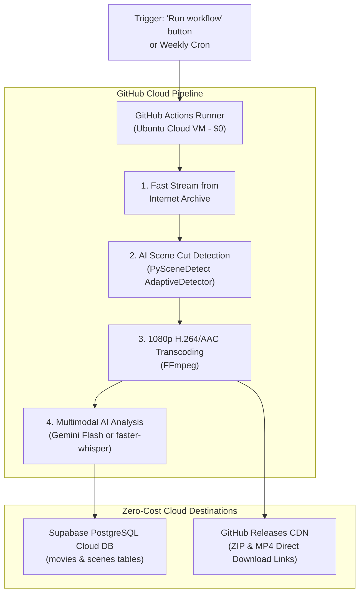

# 🎬 Film Noir Scene Extractor (GitHub Actions + Supabase Edition)

A completely cloud-hosted, zero-cost pipeline running on **GitHub Actions** and indexed into **Supabase (cloud PostgreSQL)**.

It downloads public domain film-noir classics from the Internet Archive, detects scene cuts using computer vision, extracts 3 random 1080p clips (10s–60s) with AAC/H.264, generates multimodal AI metadata (audio transcript, visual description, mood, synopsis, tropes), publishes a **GitHub Release** with direct download links, and indexes all metadata into your **Supabase database**.

---

## 🏗️ Architecture Overview



---

## 🚀 Quick Setup Guide (Takes ~3 minutes)

### Step 1: Set Up Supabase (100% Free)
1. Go to **[supabase.com](https://supabase.com)** and create a free account.
2. Click **New project** (name it e.g. `noir-catalog`, choose any free region, set a database password).
3. In your Supabase project dashboard, open the **SQL Editor** (from the left menu).
4. Click **New Query**, paste the contents of [`schema.sql`](./schema.sql), and click **Run**.
5. Go to **Project Settings ➔ API** and copy:
   - **Project URL** (`https://xxxxxxxx.supabase.co`)
   - **anon / public key** (or `service_role` key)

---

### Step 2: Push to GitHub
1. Create a new repository on **[github.com](https://github.com)** (can be **Private** or **Public**).
2. Push all the files from this folder (`github_supabase_version/`) to your repository:
   ```bash
   git init
   git add .
   git commit -m "Initial commit for Film Noir Extractor"
   git branch -M main
   git remote add origin https://github.com/YOUR_USERNAME/YOUR_REPO.git
   git push -u origin main
   ```

---

### Step 3: Configure GitHub Secrets
In your GitHub repository:
1. Go to **Settings ➔ Secrets and variables ➔ Actions**.
2. Click **New repository secret** and add:
   - `SUPABASE_URL`: Your Supabase Project URL (`https://xxxxxxxx.supabase.co`)
   - `SUPABASE_KEY`: Your Supabase API key
   - *(Optional)* `GEMINI_API_KEY`: Free key from [Google AI Studio](https://aistudio.google.com) (if omitted, it automatically falls back to local `faster-whisper` on the runner!)

---

### Step 4: Run the Workflow!
1. Go to the **Actions** tab in your GitHub repository.
2. Under All workflows, select **"Extract Film Noir Scenes & Index to Supabase"**.
3. Click the **Run workflow** dropdown button:
   - You can leave the input empty to pick a random public domain film noir classic, or enter an Internet Archive identifier (e.g. `Detour`, `Suddenly_1954`, `ScarletStreet1945`).
   - Click the green **Run workflow** button.

---

## 📊 Where to Find Your Output

1. **Direct Download (GitHub Releases):**
   - Click the **Releases** section on your GitHub repository homepage.
   - You will see a new release containing the `.zip` archive, standalone `.mp4` video clips, `.jpg` thumbnails, and a `scenes_summary.txt` report.
2. **Interactive Database (Supabase Dashboard):**
   - In Supabase, open the **Table Editor**.
   - Browse the `movies` and `scenes` tables to view transcripts, synopses, moods, noir tropes, and durations in a real-time web spreadsheet interface.
3. **Workflow Artifacts:**
   - On the completed workflow run page, the full bundle is also downloadable under **Artifacts** for 14 days.

---

## 💰 Cost
* **GitHub Actions:** **$0.00** (Free 2,000 mins/mo)
* **Supabase:** **$0.00** (Free tier 500 MB Postgres database)
* **AI Analysis:** **$0.00** (Gemini Flash free tier or local `faster-whisper`)
* **Video Hosting:** **$0.00** (GitHub Releases)
